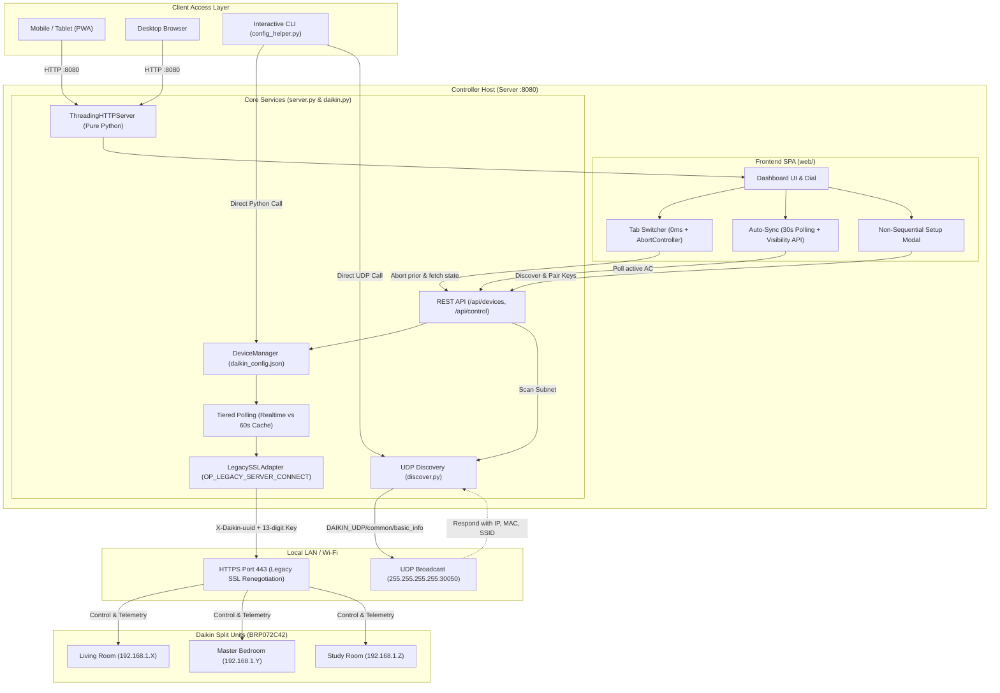

# Daikin AC LAN Controller & Web Dashboard

A lightweight, zero-cloud local network controller and real-time web dashboard for Daikin Wi-Fi air conditioners (BRP069 / BRP072 series adapter interfaces).

Operates 100% locally over your home Wi-Fi/LAN without external cloud dependencies, subscription tiers, or vendor servers.

---

## Features

- **Multi-Unit Management**: Monitor and control multiple Daikin split-system units from a single unified interface.
- **Modern Web Dashboard**: Glassmorphic, responsive web interface built for mobile, tablet, and desktop browser access on your local network.
- **Local UDP Discovery**: Automatically detect Daikin Wi-Fi adapters and their IP/MAC addresses across the subnet.
- **Full Operational Control**:
  - Power toggle (ON / OFF)
  - Operating modes: **Cool**, **Heat**, **Dry**, **Fan**, and **Auto**
  - Precision setpoint temperature adjustment (0.5 °C steps)
  - Fan speed rates (Auto, Quiet, Levels 1–5)
  - Vane swing direction (Vertical, Horizontal, 3D Airflow)
- **Real-Time Telemetry & Diagnostics**:
  - Indoor ambient temperature & humidity
  - Outdoor ambient temperature
  - Compressor operating frequency (Hz)
  - Cumulative daily runtime tracking
  - Hardware adapter metadata, firmware version, and diagnostic error codes
- **Modern OpenSSL 3 Compatibility**: Built-in legacy SSL transport adapter (`DaikinLegacySSLAdapter`) supporting legacy renegotiation (`OP_LEGACY_SERVER_CONNECT`) required by Daikin embedded controllers.

---

## Architecture & Project Structure



```text
DAIKIN_AC/
├── daikin.py                   # Core controller library & CLI tool
├── server.py                   # Lightweight HTTP & REST API server
├── discover.py                 # UDP broadcast scanner for local Daikin units
├── config_helper.py            # Interactive non-sequential CLI pairing helper
├── daikin_config.example.json  # Configuration template
├── daikin_config.json          # Active configuration (Git-ignored)
└── web/
    ├── index.html              # Dashboard markup
    ├── style.css               # Modern glassmorphism UI styles
    └── app.js                  # Frontend state machine & polling engine
```

---

## Quick Start

### 1. Requirements

- Python 3.8+
- Required Python packages:
  ```bash
  pip install requests urllib3
  ```

### 2. Pairing & Setup (Zero Manual JSON Editing)

You can pair and test your units in **any order** without manually editing JSON files:

#### Option A: Web UI Setup (Recommended)
1. Launch the server:
   ```bash
   python server.py
   ```
2. Open [http://localhost:8080](http://localhost:8080) and click **📡 Units & Keys** in the header.
3. The dashboard automatically discovers your Daikin units on Wi-Fi.
4. Type the **13-digit key** from the photo you took of each adapter's barcode sticker into its card in any order and click **Pair & Save**.
5. The dashboard tests the live handshake immediately and adds the unit to your tab bar.

#### Option B: Interactive CLI Helper
Run the terminal configuration helper:
```bash
python config_helper.py
```
- Automatically scans your Wi-Fi subnet for Daikin BRP072/BRP069 adapters.
- Select units non-sequentially, customize room names, enter sticker keys, and verify handshakes on the fly.

#### Option C: Manual Configuration
Alternatively, copy the example file:
```bash
cp daikin_config.example.json daikin_config.json
```
Edit `daikin_config.json` with your unit IPs and 13-digit sticker keys. (The `uuid` field can be left blank; a client UUID is automatically generated).

---

## Usage

### Web Dashboard & REST Server

Start the local server:

```bash
python server.py
```

- **Local Access**: Open [http://localhost:8080](http://localhost:8080) in your browser.
- **LAN / Mobile Access**: Open `http://<YOUR_PC_LAN_IP>:8080` on any phone or tablet on the same Wi-Fi network.

### Command-Line Interface (CLI)

Inspect current status directly from the terminal:

```bash
python daikin.py
```

Dump raw diagnostic JSON telemetry:

```bash
python daikin.py dump
```

---

## REST API Reference

The built-in HTTP server exposes RESTful endpoints for automation or home dashboard integrations:

| Method | Endpoint | Description |
| :--- | :--- | :--- |
| `GET` | `/api/devices` | Returns lightweight status summaries of all configured units |
| `GET` | `/api/devices/<id>` | Full real-time telemetry (temperatures, mode, fan, compressor) |
| `GET` | `/api/devices/<id>/dump` | Raw diagnostic responses from adapter firmware endpoints |
| `POST` | `/api/devices/<id>/control` | Updates unit settings (power, mode, target_temp, fan_rate, fan_dir) |

#### Example Control Request:
```bash
curl -X POST http://localhost:8080/api/devices/ac_1/control \
  -H "Content-Type: application/json" \
  -d '{"power": true, "mode": "cool", "target_temp": 24.5, "fan_rate": "A"}'
```

---

## Security & Local Privacy

- **Protected Secrets**: `daikin_config.json` is automatically excluded in `.gitignore` to prevent committing private hardware keys, internal IP addresses, and client UUIDs.
- **Local Network Scope**: The web dashboard is intended for private home network use. If exposing to the public internet, place it behind a secure reverse proxy with authentication (e.g., Caddy, Nginx, or WireGuard VPN).

---

## License

MIT License. Designed for personal and home automation use. Not affiliated with or endorsed by Daikin Industries, Ltd.
