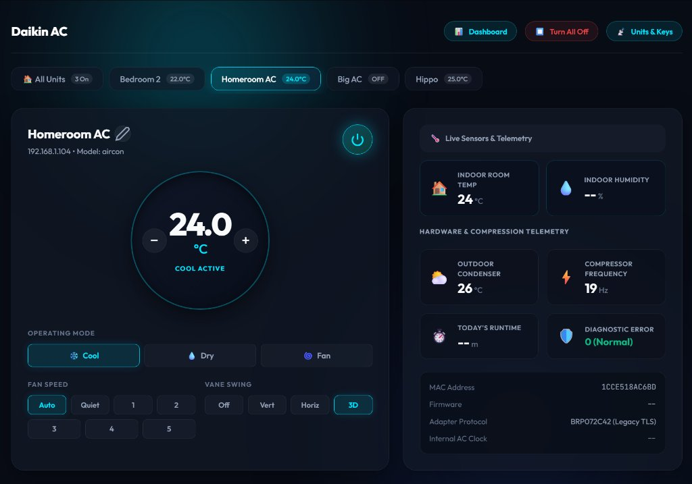
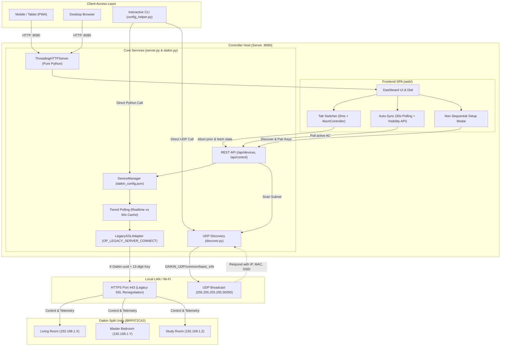

# Daikin AC LAN Controller & Web Dashboard

A lightweight, zero-cloud local network controller and real-time web dashboard for Daikin Wi-Fi air conditioners (BRP069 / BRP072 series adapter interfaces).

Operates 100% locally over your home Wi-Fi/LAN without external cloud dependencies, subscription tiers, or vendor servers.

<p align="center">
  
</p>

---

## Features

- **Multi-Unit Management**: Monitor and control multiple Daikin split-system units from a single unified interface.
- **Modern Web Dashboard**: Glassmorphic, responsive web interface built for mobile, tablet, and desktop browser access on your local network.
- **Local UDP Discovery**: Automatically detect Daikin Wi-Fi adapters and their IP/MAC addresses across the subnet.
- **Full Operational Control**:
  - Power toggle (ON / OFF)
  - Operating modes: **Cool**, **Heat**, **Dry**, **Fan**, and **Auto**
  - Precision setpoint temperature adjustment (0.5 °C steps)
  - Fan speed rates (Auto, Quiet, Levels 1–5)
  - Vane swing direction (Vertical, Horizontal, 3D Airflow)
- **Real-Time Telemetry & Diagnostics**:
  - Indoor ambient temperature & humidity
  - Outdoor ambient temperature
  - Compressor operating frequency (Hz)
  - Cumulative daily runtime tracking
  - Hardware adapter metadata, firmware version, and diagnostic error codes
- **Modern OpenSSL 3 Compatibility**: Built-in legacy SSL transport adapter (`DaikinLegacySSLAdapter`) supporting legacy renegotiation (`OP_LEGACY_SERVER_CONNECT`) required by Daikin embedded controllers.

---

## Architecture & Project Structure


```text
DAIKIN_AC/
├── daikin.py                   # Desktop controller library & CLI tool
├── server.py                   # Desktop ThreadingHTTPServer & REST API
├── discover.py                 # Desktop UDP broadcast scanner
├── config_helper.py            # Interactive non-sequential CLI pairing helper
├── daikin_config.example.json  # Configuration template
├── daikin_config.json          # Active configuration (Git-ignored)
├── deploy_ota.example.ps1      # Template for the wireless WebREPL deployer (copy to scripts/, git-ignored)
├── micropython/                # MicroPython ESP32 Asynchronous Firmware
│   ├── boot.py                 # Boot sequence, Wi-Fi initialization & WebREPL
│   ├── config.py               # Central configuration & timing constants
│   ├── daikin.py               # Non-blocking async Daikin engine (asyncio streams)
│   ├── main.py                 # uasyncio HTTP server, decoupled poller & GC task
│   ├── discover.py             # Cooperative non-blocking UDP discovery
│   ├── daikin_config.json      # Unit configuration file
│   └── web/                    # Pre-compressed web assets (.html/.css/.js + .gz)
└── web/
    ├── index.html              # Dashboard markup
    ├── style.css               # Modern glassmorphism UI styles
    └── app.js                  # Frontend state machine & polling engine
```
---

## Quick Start

### 1. Requirements

- Python 3.8+
- Required Python packages:
  ```bash
  pip install requests urllib3
  ```
### 2. Pairing & Setup (Zero Manual JSON Editing)

You can pair and test your units in **any order** without manually editing JSON files:

#### Option A: Web UI Setup (Recommended)
1. Launch the server:
   ```bash
   python server.py
   ```
2. Open [http://localhost:8080](http://localhost:8080) and click **📡 Units & Keys** in the header.
3. The dashboard automatically discovers your Daikin units on Wi-Fi.
4. Type the **13-digit key** from the photo you took of each adapter's barcode sticker into its card in any order and click **Pair & Save**.
5. The dashboard tests the live handshake immediately and adds the unit to your tab bar.

#### Option B: Interactive CLI Helper
Run the terminal configuration helper:
```bash
python config_helper.py
```
- Automatically scans your Wi-Fi subnet for Daikin BRP072/BRP069 adapters.
- Select units non-sequentially, customize room names, enter sticker keys, and verify handshakes on the fly.

#### Option C: Manual Configuration
Alternatively, copy the example file:
```bash
cp daikin_config.example.json daikin_config.json
```
Edit `daikin_config.json` with your unit IPs and 13-digit sticker keys. (The `uuid` field can be left blank; a client UUID is automatically generated).

---

## Usage

### Web Dashboard & REST Server

Start the local server:

```bash
python server.py
```
- **Local Access**: Open [http://localhost:8080](http://localhost:8080) in your browser.
- **LAN / Mobile Access**: Open `http://<YOUR_PC_LAN_IP>:8080` on any phone or tablet on the same Wi-Fi network.

### Command-Line Interface (CLI)

Inspect current status directly from the terminal:

```bash
python daikin.py
```
Dump raw diagnostic JSON telemetry:

```bash
python daikin.py dump
```
---


---

## MicroPython ESP32 Asynchronous Hub (uasyncio Architecture)

The micropython/ directory houses the standalone embedded controller designed for low-power ESP32 microcontrollers (e.g., Seeed Studio XIAO ESP32-C5):

- **Event Loop Cooperative Multitasking**: Built on MicroPython's native `uasyncio` engine. Zero blocking `time.sleep()` loops; all delays use `await asyncio.sleep()` to yield CPU cycles.
- **Single-Digit Millisecond HTTP Responses**: Incoming web requests (`GET /api/devices`, `GET /api/devices/<id>`) are strictly served from the shared in-memory RAM cache (`app_state['units']`), eliminating network roundtrips mid-request.
- **Decoupled Background Polling Task**: `poll_units_task()` asynchronously probes all 4 Daikin units using non-blocking socket streams (`asyncio.open_connection`), staggered evenly across 16-second intervals to minimize TLS RAM overhead.
- **SO_REUSEADDR HTTP Server**: The HTTP server runs on port 80 via `asyncio.start_server()` with `SO_REUSEADDR` enabled, preventing socket lockups across warm reboots.
- **Heap Hygiene & Memory Safety**: Includes a periodic `gc_task(interval_secs=30)` and chunked 1024-byte file streaming with pre-compressed Gzip asset negotiation (`.html.gz`, `.css.gz`, `.js.gz`), keeping RAM usage well within ESP32 headroom.
- **Robust Network Error Isolation**: All AC network I/O operations are guarded with `try...except (OSError, asyncio.TimeoutError)` blocks, so dropped frames or offline units never crash the event loop or block WebREPL.
- **Wireless OTA Deployment**: Upload code and web assets wirelessly via WebREPL using a local deploy script (see `deploy_ota.example.ps1`). OTA never touches `boot.py` or `daikin_config.json`.

## REST API Reference

The built-in HTTP server exposes RESTful endpoints for automation or home dashboard integrations:

| Method | Endpoint | Description |
| :--- | :--- | :--- |
| `GET` | `/api/devices` | Returns lightweight status summaries of all configured units |
| `GET` | `/api/devices/<id>` | Full real-time telemetry (temperatures, mode, fan, compressor) |
| `GET` | `/api/devices/<id>/dump` | Raw diagnostic responses from adapter firmware endpoints |
| `POST` | `/api/devices/<id>/control` | Updates unit settings (power, mode, target_temp, fan_rate, fan_dir) |

#### Example Control Request:
```bash
curl -X POST http://localhost:8080/api/devices/ac_1/control \
  -H "Content-Type: application/json" \
  -d '{"power": true, "mode": "cool", "target_temp": 24.5, "fan_rate": "A"}'
```
---

## Security & Local Privacy

- **Protected Secrets**: `daikin_config.json` is automatically excluded in `.gitignore` to prevent committing private hardware keys, internal IP addresses, and client UUIDs.
- **Local Network Scope**: The web dashboard is intended for private home network use. If exposing to the public internet, place it behind a secure reverse proxy with authentication (e.g., Caddy, Nginx, or WireGuard VPN).

---

## License & Disclaimers

This project is licensed under the **[MIT License](LICENSE)**.

### Legal Notice & Trademark Disclaimer
- **Non-Affiliation**: This repository is an independent, community-driven open-source project. It is **not** affiliated with, authorized, sponsored, maintained, or endorsed by Daikin Industries, Ltd., or any of its subsidiaries.
- **Trademarks**: "Daikin", "BRP072C42", "BRP069", and related marks or logos are registered trademarks of Daikin Industries, Ltd. All product names, trademarks, and registered trademarks are property of their respective owners and are used here solely for nominative identification and interoperability purposes.
- **HVAC Equipment & Safety Disclaimer**: Air conditioners contain high-voltage electrical circuits and pressurized refrigerant compressors. Use of this software is at your own risk. The author(s) assume no liability for compressor wear, electrical damage, operational disruption, or voided manufacturer warranties resulting from direct LAN automation or commands dispatched by this software.
